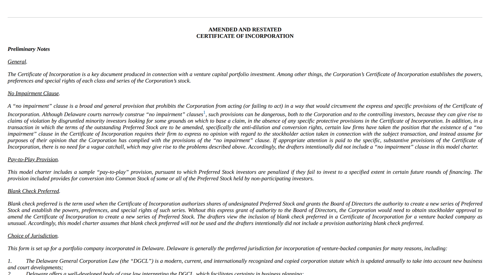
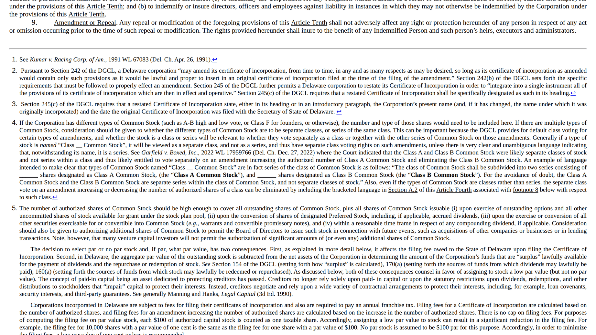

# DOCX to HTML Converter

This document describes the architecture and capabilities of the `WmlToHtmlConverter` module, which converts Word documents (`.docx`) to XHTML.

**Source File:** `OpenXmlPowerTools/WmlToHtmlConverter.cs`

## Overview

The converter transforms Open XML WordprocessingML documents into well-formed XHTML with CSS styling. It processes the document through a multi-stage pipeline that resolves formatting, calculates layout metrics, and transforms elements to their HTML equivalents.



The [NVCA model certificate of incorporation](https://nvca.org/model-legal-documents/) in flow mode.
Justification, style-inherited italics, superscript footnote references and legal numbering all
survive the conversion — resolved by the pipeline below rather than approximated.



With `RenderFootnotesAndEndnotes` on, notes render as a numbered section with a back-reference to
the citing paragraph. In paginated mode the same notes are placed at the bottom of the page that
cites them, above a separator rule — see [`paginated_headers_footers.md`](paginated_headers_footers.md).

## Entry Points

```csharp
// From a WmlDocument (in-memory byte array wrapper)
XElement html = WmlToHtmlConverter.ConvertToHtml(wmlDoc, settings);

// From an open WordprocessingDocument
XElement html = WmlToHtmlConverter.ConvertToHtml(wordDoc, settings);

// Via extension method on WmlDocument
XElement html = wmlDoc.ConvertToHtml(settings);
```

All methods return an `XElement` representing the complete HTML document (the `<html>` element with `<head>` and `<body>`).

Serialize it with `html.ToString()` or `html.ToString(SaveOptions.DisableFormatting)`.
Stylesheets use CSS-commented CDATA sections so child selectors (`p > span`), ampersands,
and CSS string values survive both XML parsing and HTML raw-text parsing (issue #1230).
CSS escapes protect embedded `</style` and `]]>` delimiters without changing string values,
including a less-than sign that the authored CSS already escapes.
The byte-to-HTML facade used by WASM and the stdio host uses this same serialization.
When manipulating the returned tree, preserve its stylesheet nodes rather than replacing
`style.Value` with plain XML text, which would reintroduce entity escaping.

## Configuration

### WmlToHtmlConverterSettings

| Property | Type | Default | Description |
|----------|------|---------|-------------|
| `PageTitle` | `string` | `""` | Content for the `<title>` element |
| `CssClassPrefix` | `string` | `"pt-"` | Prefix for generated CSS class names |
| `FabricateCssClasses` | `bool` | `true` | If true, generates CSS classes; if false, uses inline styles |
| `GeneralCss` | `string` | `"span { white-space: pre-wrap; }"` | Base CSS included in output |
| `AdditionalCss` | `string` | `""` | Custom CSS appended to the style block |
| `RestrictToSupportedLanguages` | `bool` | `false` | Limits language processing |
| `RestrictToSupportedNumberingFormats` | `bool` | `false` | Limits list numbering formats |
| `ListItemImplementations` | `Dictionary<string, Func<...>>` | Default implementations | Custom list item text generators |
| `ImageHandler` | `Func<ImageInfo, XElement>` | `null` | **Required for images** - callback to process embedded images |
| `SemanticLists` | `bool` | `false` | Emit Word lists as `ol`/`ul`/`li` instead of paragraphs (see [Lists](#lists)); ignored by paginated output |
| `NormalizeBulletMarkers` | `bool` | `false` | With semantic lists, draw familiar bullets through CSS even when marker formatting differs |
| `StampPageNumberFields` | `bool` | `false` | Preserve `PAGE` / `NUMPAGES` as `data-field` spans in flow output, including empty results; retain cached text, formatting and `data-field-format` switches without calculating page numbers. Paginated output always marks these fields. Exposed as npm `stampPageNumberFields` and Python `stamp_page_number_fields`. |
| `ShowFormattingChanges` | `bool` | `true` | With `RenderTrackedChanges`, show formatting-change annotations; current formatting remains when false |
| `ShowInsertionsAndDeletions` | `bool` | `true` | With `RenderTrackedChanges`, show text/structural revisions; false displays current text and structure without accepting revisions |

### ImageInfo Structure

When `ImageHandler` is invoked, it receives an `ImageInfo` object:

```csharp
public class ImageInfo
{
    public SKBitmap? Bitmap;           // Decoded image (SkiaSharp)
    public byte[]? ImageBytes;         // Encoded output bytes; TIFF/WMF may be normalized
    public XAttribute? ImgStyleAttribute; // Pre-computed style attribute with dimensions
    public string? ContentType;        // MIME type (e.g., "image/png")
    public XElement? DrawingElement;   // Original Word XML element
    public string? AltText;            // Description from document

    public const int EmusPerInch = 914400;
    public const int EmusPerCm = 360000;

    public void SaveImage(string filePath, SKEncodedImageFormat format, int quality = 100);
}
```

## Processing Pipeline

Paginated paragraph projection shares one recursive splitter for explicit page and column breaks.
It lifts page markers into sibling blocks, preserving inline formatting and canonical source IDs
without duplicating HTML/editor targets. Textboxes remain separate stories. Empty pre-break
carriers use the paginator's existing zero-height source exclusion; ordinary authored blank lines
and whitespace remain content. A terminal page break ends its paragraph on the old page unless
`w:splitPgBreakAndParaMark` explicitly requests a paragraph-mark line on the next page (#1570).
When editable anchors are requested, a `data-docx-break-paragraph` wrapper identifies the source
owner and keeps all pieces together for single, batch and windowed block extraction. The paginator
unwraps it before source inventory and column layout. The editable head retains a split marker so
text and format edits repaint the complete source across pages; an empty head uses a span insertion
to preserve the following break and text.

The conversion happens in the following stages:

### 1. Preprocessing

XML normalizes raw CR/CRLF to LF. Before formatting, LF characters in `w:t` and
`w:delText` become spaces; explicitly encoded CR characters remain breaks. Literal tabs use the same tab-stop path as `w:tab`;
explicit `w:br` / `w:cr` elements and field instructions retain their meaning (#1564).
Shared `PutXDocument` writers entitize surviving CR characters so revision projection
and session saves do not turn them into LF before conversion. This preserves text
character identity without changing the existing BOM or formatting policy.

Run coalescing visits nested containers from the leaves upward on one copy of the input tree.
Each container, including textbox paragraphs, is consolidated once (#1410).

Markup visibility is prepared on that owned copy after canonical source indexing and author
palette collection, before simplification and formatting assembly. Hidden paragraph-mark
revisions use the joined paragraph's current properties for inherited formatting and numbering;
surviving source identities remain attached. Hidden-only comments are filtered before resource
inventory. This path does not call revision acceptance or rewrite the caller's package (#1523).

VML drawing containers project each independent member, with nested group coordinate maps
preserving individual textbox and picture bounds (#1482). The ordinary textbox paragraph
converter still owns formatting, contextual spacing, source identities and fixed-box clipping.
DrawingML groups and drawing canvases use the same member walker: a canvas uses its own
coordinate space, while nested groups apply their child offsets and scale (#1561).
The host records expected textbox identities from selected source OOXML; the image/chart paths
record only their actual selected alternatives so a missing image can still fall back to text.
This makes conversion-time loss observable to the paginator's existing completeness check.

```
WordprocessingDocument
    │
    ├─► RevisionAccepter.AcceptRevisions()
    │       Accepts all tracked changes (insertions/deletions)
    │
    ├─► MarkupSimplifier.SimplifyMarkup()
    │       Removes: comments, content controls, footnotes/endnotes,
    │                proofing marks, permissions, RSID info, smart tags,
    │                soft hyphens, GoBack bookmarks
    │
    ├─► FormattingAssembler.AssembleFormatting()
    │       Resolves style inheritance, flattens formatting to explicit properties
    │
    ├─► InsertAppropriateNonbreakingSpaces()
    │       Ensures empty paragraphs render (adds space to empty <p>)
    │
    ├─► CalculateSpanWidthForTabs()
    │       Computes tab widths using font metrics (SkiaSharp)
    │
    ├─► ReverseTableBordersForRtlTables()
    │       Swaps left/right borders for RTL tables
    │
    ├─► AdjustTableBorders()
    │       Resolves conflicting cell borders by priority
    │
    ├─► FieldRetriever.AnnotateWithFieldInfo()
    │       Marks field code regions for hyperlink processing
    │
    └─► AnnotateForSections()
            Marks section boundaries for grouping
```

### 2. Transformation

`ConvertToHtmlTransform()` recursively walks the document tree, converting each element:

```
w:document  ──►  <html>
                   <head>
                     <meta charset="UTF-8"/>
                     <title>...</title>
                     <meta name="Generator" content="PowerTools for Open XML"/>
                   </head>
                   <body>...</body>
                 </html>

w:body      ──►  <body> with section <div> wrappers

w:p         ──►  <p> or <h1>-<h6> (based on outlineLvl in style)

w:r         ──►  <span> with CSS styling

w:t         ──►  text node

w:tbl       ──►  <table> wrapped in alignment <div>

w:tr        ──►  <tr>

w:tc        ──►  <td> with colspan/rowspan

w:hyperlink ──►  <a href="...">

w:drawing   ──►  Result of ImageHandler callback
w:pict

w:tab       ──►  <span> with calculated width

w:br/w:cr   ──►  <br> with directional marks

w:sym       ──►  <span>&#NNN;</span> (symbol as entity)

w:bookmarkStart ──► <a id="..."></a>  (<span id="..."></span> inside a link: an <a> cannot nest)

w:noBreakHyphen ──► "-" (text)
```

### 3. CSS Generation

`ReifyStylesAndClasses()` processes style annotations attached to elements:

**With `FabricateCssClasses = true` (default):**
- Groups elements with identical styles
- Generates CSS class names (e.g., `pt-000001`, or `pt-StyleName` if available)
- Adds `class` attribute to elements
- Creates `<style>` block in `<head>`

**With `FabricateCssClasses = false`:**
- Converts style dictionaries to inline `style` attributes

## Element Mapping Details

### Paragraphs

Paragraphs (`w:p`) are converted based on their style's outline level:

| Outline Level | HTML Element |
|---------------|--------------|
| 0 | `<h1>` |
| 1 | `<h2>` |
| 2 | `<h3>` |
| 3 | `<h4>` |
| 4 | `<h5>` |
| 5 | `<h6>` |
| None/other | `<p>` |

Hidden paragraph marks (`w:pPr/w:rPr/w:vanish`) and style separators (`w:specVanish`)
render following paragraph text as a `<span>` within the first paragraph or heading. Explicit off
values preserve separate blocks. Joining stops at another block container or a section boundary;
range markers such as bookmarks do not create a physical boundary. In paginated mode the merged block takes `data-keep-with-next` and
`data-keep-lines` from its last paragraph (the mark that precedes the next block, so a run-in
heading's own `keepNext` does not chain the block to what follows), and start-anchored
properties such as `data-page-break-before` from its first. Paragraph-mark visibility
does not hide the generated list number; run defaults, run styles, and numbering-level visibility
still apply to the number.

### Paragraph text frames

`w:framePr` identifies a floating paragraph frame. Adjacent paragraphs with identical frame
attributes share one frame, anchored to the next ordinary paragraph, as specified by
[OOXML FrameProperties](https://learn.microsoft.com/en-us/dotnet/api/documentformat.openxml.wordprocessing.frameproperties?view=openxml-3.0.1).
The converter groups their ordinary paragraph HTML inside one `data-docx-text-frame` wrapper.
A placeholder keeps the frame with its following anchor. Drop-cap properties retain their
existing conversion path. Explicit automatic height ignores the stored height; exact and minimum
heights retain their declared size. Omitted anchors use Word's text-relative defaults
([MS-OE376](https://learn.microsoft.com/en-us/openspecs/office_standards/ms-oe376/6ff920ba-f035-407d-aa15-c4e2ad916cb6)).

For `w:yAlign="inline"`, `w:wrap="notBeside"` gives the placeholder the frame's flow height.
Text-anchored `around`, `auto`, `tight` and `through` frames with left-edge placement or explicit
offsets instead leave a zero-height source slot and exclude their occupied area, including
`hSpace`, from following lines. Separate frames keep their own
source positions. `prepareFrameExclusions` represents the active rectangles with a float whose
right edge follows their union, ending each float at the next frame's source slot. That next
slot carries any surviving rectangles into a new exclusion. This prevents CSS float packing
from shifting frames sideways and prevents a later, wider frame from moving an earlier table.
Adjacent distinct frames share one slot; paragraphs with identical properties share one frame.
`wrap="none"` retains overlap. Inline frames directly in a table cell become ordinary paragraphs,
as in Word; a nested text-box story is a separate frame context.

Body admission counts a wrapping frame's painted extent separately from normal flow height.
Header overhangs narrow body lines without consuming that height a second time. Tables and other
formatting contexts that must move below an exclusion contribute their measured clearance after
margin collapse. Running stories use the same wrapping geometry when their fields are refreshed.

The paginator resolves page, margin and text anchors after the ordinary content has flowed.
It then places the frame directly in its page so body and running-story clipping cannot crop
its overhang. Inherited presentation, canonical source identities and table-cell ownership
survive placement; the PageMap measures the positioned source paragraphs. Ordinary running-story
paragraphs retain their existing conversion. Floating-frame geometry supports explicit offsets and
horizontal/vertical alignment.

Inline wrapping uses the same horizontal anchor resolver during measurement and final placement.
A union touching the left text edge keeps native CSS float wrapping. Interior or right-side
rectangles instead divide each line into available intervals; the existing legal DOM Range
splitter fills those intervals while preserving runs and source ownership. Derived line boxes
are disposable: fragment tails and page-specific running stories recompute them at their new
positions. An unbreakable word advances below the exclusion when neither interval can hold it.

The converter retains a pending diagnostic until pagination verifies the affected layout.
Simple left-to-right Latin paragraphs with measurable line heights are supported. Complex scripts,
bidi runs, hard breaks, inline objects and affected tables or other independent formatting
contexts keep the conservative fallback and warning; strict export refuses those arrangements.
Positive `vSpace` expands the exclusion above and below the fixed painted rectangle. The
paginator replays affected preceding paragraphs from their source content and measures the
change in ordinary flow before admitting a frame. That extra height participates in keep-chain,
fragment and note budgets; a deferred frame leaves the earlier page unchanged. The same replay
runs for running stories and final pages. Zero-distance `notBeside`, `none` and non-inline frames keep
their existing behavior. Running-story measurement includes physical page parity, independently
of displayed page-number restarts.

### Linked DrawingML text boxes

A `wps:txbx` start and matching `wps:linkedTxbx` continuations form a story within their
owning document part. The converter retains empty continuation frames and records the story,
sequence and linked membership on their wrappers. Membership is recomputed for each conversion,
so editing a document and rendering it again cannot leave stale clipping eligibility. Linked
stories are excluded from fixed-box clipping exemptions.

With read-only paragraph fragmentation enabled, the paginator flows the story through the
frames in sequence using the shared paragraph fragmenter. Frame sizes and inherited typography
are retained; text and inline pictures move as complete supported fragments. Fitting keep groups
move together, while keeps that cannot fit any available frame may relax. Repeated header/footer
chains are resolved separately on each physical page. Source identities continue across frames
and pages through the ordinary PageMap path.

Fit checks include all four content bounds, including the upper edge of vertically aligned
frames. Invalid chains, indivisible content that fits no frame, and exhausted story capacity
report an export error instead of discarding the remaining content.

### Runs (Text Formatting)

After CSS generation, adjacent ordinary text spans with identical output attributes join.
This avoids splitting words because source runs had different bookkeeping IDs or properties
with no HTML effect (#1624). Text nodes, including directional entities, move intact; block
anchors remain unchanged. Fields, bookmarks, other semantic markers, exact-line metadata,
custom-property styles and spans defining layout boxes retain their boundaries.

Run properties (`w:rPr`) map to CSS:

| Word Property | CSS Property | Notes |
|--------------|--------------|-------|
| `w:b` | `font-weight: bold` | |
| `w:i` | `font-style: italic` | |
| `w:u` | `text-decoration: underline` | Unless `val="none"` |
| `w:strike`, `w:dstrike` | `text-decoration: line-through` | |
| `w:caps` | `text-transform: uppercase` | |
| `w:smallCaps` | `font-variant: small-caps` | |
| `w:vanish` | `display: none` | Unless `w:specVanish` |
| `w:color` | `color: #RRGGBB` | `auto` → `black` |
| `w:highlight` | `background: <color>` | Named colors |
| `w:shd` | `background: #RRGGBB` | With pattern blending |
| `w:sz` | `font-size: Npt` | Value in half-points |
| `w:spacing` | `letter-spacing: Npt` | |
| `w:position` | `position: relative; top: Npt` | Superscript/subscript offset |
| `w:vertAlign` | `<sup>` or `<sub>` wrapper | `superscript`/`subscript` |
| `w:bdr` | `border: solid windowtext 1pt` | |

### Tables

For fixed tables with positive grid widths and explicitly sized single-line borders,
`WmlToHtmlConverter.TableBorders.cs` resolves physical edge segments before the legacy
CSS adjustment. Shared segments keep one complete winning border, including its color;
merged cells do not spread that winner over unrelated segments. RTL normalization visits
all content parts and transparent row/cell wrappers. Ordinary HTML retains native CSS borders.

Paginated export replaces those quantized CSS boxes before measuring. A cell's horizontal
content width is its grid width less `max(margin, half-border)` on each side, using the same
winning widths for native tab wrapping. This follows the existing Word placement captures
in `TestFiles/TableHorizontalPlacement`; vertical row padding includes the resolved halves.
Exact rows recalculate their content clips, while an automatic height remains automatic.
The paginator resolves each repeated header's new neighbor before fitting the fragment and
reserves the visible outer edges at its top, bottom and aligned trailing side.
Borderless cells use separate layout with zero spacing so the outer vertical halves can
be table padding. This reservation cannot collapse into neighboring paragraph margins,
and the alignment wrapper retains its existing float-clearance behavior.
Export supplies this refresh through the paginator's synchronous internal
`prepareTableFragment` hook; editor/viewer bundles do not load the export-only border layout.

Final edges paint as SVG rectangles beside their source table, preserving source stacking
order, affine transforms and ancestor clips. Shared boundaries paint once by source segment
identity. A local SVG shares Chromium's existing transformed HTML paint-origin rounding;
paired PDF controls verify alignment with neighboring HTML ink and the exact declared width.
This does not claim a general correction of transformed HTML print origins. Tables with
unsupported border styles or unresolved grids continue through the existing native renderer.

Standalone export fits uniform scaled cell text after table widths and borders resolve,
before pagination measures block heights. Each enclosing table must carry the converter's
authored fixed-width marker and a resolved column grid. The export-only `prepareTableText`
hook reuses the body paragraph line fitter; continued cells and repeated headers retain its
lines. Fractional-baseline rounding accumulates within each cell independently. AutoFit,
percentage-width and unresolved tables, unscaled cells and richer runs keep their current flow.

Running headers and footers use the same text fitter inside their measured content band,
after table widths resolve and before their height is reserved. Each section owns a separate
registry clone, including inherited stories; page clones retain that section's fitted lines.
Field-bearing runs and wrapping-frame stories keep their existing layout guards. Note
continuations require separate preparation that shares their measurement and final paint.

Tables are wrapped in a `<div>` for alignment control:

```html
<div dir="ltr" align="left">
  <table dir="ltr" style="border-collapse: collapse; border: none; ...">
    <tr style="height: 0.25in">
      <td colspan="2" rowspan="1" style="border: solid black 1pt; ...">
        <!-- cell content -->
      </td>
    </tr>
  </table>
</div>
```

**Border Conflict Resolution:**

When adjacent cells have different borders, priority is determined by:
1. Border style weight (single < thick < double < dotted, etc.)
2. Border size (`w:sz` attribute)
3. Border style type priority
4. Color value (lower hex value wins)

### Hyperlinks

**External links** (`w:hyperlink` with `r:id`):
```html
<a href="https://example.com" style="color: inherit; text-decoration: none">link text</a>
```

**Bookmark links** (`w:hyperlink` with `w:anchor`):
```html
<a href="#bookmarkName" style="color: inherit; text-decoration: none">link text</a>
```

Hyperlink conversion preserves child containers and revision wrappers as well as direct runs,
using the existing tab-layout path. Custom XML shares the content-control traversal: its metadata
does not render, while its content flows through inline conversion or block border grouping. This
applies to normal and paginated HTML (#1188).

The anchor suppresses browser-default link presentation. Explicit Word run styling inside the link
still wins in ordinary links. Cached `TOC` field results are the semantic exception: Word suppresses
hyperlink color and underline there even when a run references the `Hyperlink` character style.
`FieldRetriever` annotates the complex-field stack before transformation, and run conversion removes
only those two presentation properties when the run is both inside `w:hyperlink` and inside a `TOC`
result. Removing rather than replacing them exposes the document's underlying TOC formatting.

**HYPERLINK fields** (detected via `FieldRetriever`):
```html
<a href="url-from-field">field content</a>
```

### Ruby annotations

`WmlToHtmlConverter.Ruby.cs` resolves ruby size precedence before formatting assembly: `w:hps`
overrides annotation run sizes, while an explicit base run size wins over `w:hpsBaseText`.
Direct horizontal text runs use `ruby` / `rt` / `rp`, retaining run formatting and annotation
language. A marked inline-block wrapper keeps the pair atomic. The shared line-metrics pass
measures native ruby baselines after font preparation, shifts the annotation to the authored
baseline distance, and reserves the corresponding signed change in line height, including
hidden note registries. Fragment endpoints never enter the pair; line-boundary decisions use
the base, while annotation ink remains part of layout measurement.
Chromium's PDF paint path can round the measured baseline distance to CSS pixels; its tagged
output retains pair association, with role names depending on the Chromium version. See the
Ruby corner case for the measured bounds.

Vertical ruby alignment, bidi paragraphs, tabs, exact-spaced paragraphs and shifted/scripted
runs use a complete readable fallback. Its diagnostic participates in the existing strict
export policy. With placeholders disabled, both text layers still render. Exact fallback
runs share the enclosing run's baseline correction and use their own natural line heights.

### Tabs

Before revision acceptance, simplification and formatting, `ExpandLiteralTextTabs` replaces literal
U+0009 characters in `w:t` and `w:delText` with canonical `w:tab` elements across all content parts
(#1353). This includes a tab-only run, mixed text, and leading, consecutive or trailing tabs. Text
fragments retain their attributes and their run's formatting/revision owner. Field instructions
(`w:instrText`) remain unchanged: their tab characters are instruction whitespace, not layout tabs.
The normal stop, leader and browser-flex calculations below then handle both representations.
Revision wrappers reuse the same aligned-tab renderer as paragraph content when field boundaries
permit it. Tab measurements include visible deleted text and skip hidden deletion/move-source
content, so hidden revisions do not advance the live pen. Revision ownership and formatting stay
on the outer wrapper and its runs. Neutral flex segments and text items explicitly inherit
text decoration, because CSS does not paint an outer revision's underline or strike through
an atomic inline flex box.

`CalculateSpanWidthForTabs` measures the current position and following segment, then annotates each
tab with the advance needed for its OOXML target. Left/right tab sequences use character-class
fallback widths to choose a stop; fixed-pitch prefixes retain constant advances. Plain left/right
segments in left-to-right paragraphs become fixed-width inline flex rows, including the following text in a right segment.
The browser assigns font-metric differences to the tab remainder, so later tabs retain their own
stops and page-number right edges follow actual glyph widths. The same grouping is used inside
`w:hyperlink`. Bookmarks, non-breaking hyphens and underlined or struck tab runs stay on the flex path. A
right stop past the line end (inside the paragraph's right indent, or past the column edge) gives its segment
a negative `margin-right` equal to the overhang, so the segment fits on its line and still ends on the stop.
Past the line end the line has no room left, yet LibreOffice keeps a short later tab stretch on the same line, so
the following content goes in one nowrap, content-wide box whose left margin undoes that overhang and whose `-100%` right margin takes it off the line; a
second right or left stop inside the indent then lands on its own stop (issue #1285). A pen past the line
end only because a right-aligned stretch ended on such a stop does not count as wrapped text.
If text after the final left tab would exceed the column edge, the paragraph keeps the ordinary wrapping
path. Forcing that text into the same nowrap box would send it past the page and lose visible words.
Likewise, a right tab whose following text exceeds both the column and its authored stop keeps
ordinary, fragmentable flow (#1488). Its following width is the sum of the actual runs' resolved
fonts and sizes, with letter spacing included by the shared run measurement. A short tail whose
browser glyphs are wider than that estimate can shrink and wrap within its segment; fitting tails
still end on their stop. Deliberate overhanging stops retain their existing treatment.

Complex fields stay on the flex path: their begin, instruction, separator and end runs draw nothing, so a
table-of-contents page number held in a `PAGEREF` field ends on the stop like plain text (issue #1285).
Each stretch converts its fields on its own, so a field open across a tab would be cut in two; a field the
converter wraps whole (a `HYPERLINK` link, or a `PAGE`/`NUMPAGES` marker) therefore keeps the run-aware
path when it is cut. A form field's begin carries form data that renders, and also keeps that path.

Text before a right tab that runs past the line end usually keeps the run-aware path (issue #891). When
that text began at the left indent, where its later lines begin too (a long hanging-indent TOC title), the
segment instead starts at the left indent and reaches the stop. The text wraps inside it at the line end,
and the segment aligns its last line with the following text (`align-items: last baseline`), so the page
number ends on the stop beside the last title line. The tab takes no room after the title's last word;
its leader is as wide as the segment and is clipped (`overflow-x: clip`) where the number begins.
The prefix keeps its minimum word width, and the segment can wrap onto another flex line if
the following text leaves less room than that. This prevents an underestimated tail from
collapsing the clipped title to zero width; fitting page-number lines retain their geometry.

Bidirectional paragraphs, breaks, active comment/annotation ranges (including a bookmark
that opens a rendered annotation) and tab runs with visibility, revision or exceptional geometry retain
the run-aware path and its conservative following-text reservations. Leader rules inherit the tab run's resolved foreground color.

```html
<span style="align-items: baseline; display: inline-flex; width: 4.000in">
  <span style="flex-shrink: 0">Before</span>
  <span style="display: inline-block; flex: 1 1 0; min-width: 0; color: blue">
    <span data-docx-tab="right" data-docx-tab-width="3.500" style="width: 100%"></span>
  </span>
  <span style="flex-shrink: 0">After</span>
</span>
```

**Tab types supported:**
- `left`/`start` - Content starts at tab position
- `right`/`end` - Content ends at tab position
- `center` - Content centered at tab position
- `decimal` - Decimal point aligned at tab position

**Tab leaders:**
- `dot` (.) `hyphen` (-) `underscore` (_)
- Rendered as dotted, dashed, or solid rules across the exact tab box; leader fill therefore does
  not depend on whether the document font is installed in the native or WASM runtime.

### Images

Images require an `ImageHandler` callback. PNG, GIF and JPEG retain their encoded bytes.
The shared DrawingML/VML path in `WmlToHtmlConverter.Images.cs` normalizes three bounded subsets
before invoking that callback, identically in native and WASM builds:

- Classic, single-page TIFF: chunky unsigned 8-bit RGB/RGBA, uncompressed or PackBits strips,
  either byte order, orientations 1–8 and associated/unassociated alpha. Output is RGBA PNG.
  LZW/Deflate, tiles, palette/grayscale, custom colorimetry/profiles and multi-page files retain
  an unsupported-content diagnostic.
- Placeable WMF (`image/x-wmf` or `image/wmf`): positive anisotropic windows, rectangle/ellipse
  records and positive-width solid/null pens and solid/null brushes. Output is static SVG with
  a bounded object table and record count. Word's device-pixel endpoint exclusion is resolved
  in logical coordinates; window mapping and later picture sizing stretch the complete painted
  graphic, including its outline. Visible zero-width device pens, collapsed bounds and unknown
  records reject the whole image; text, bitmaps, clipping and other map modes remain unsupported.
- Base-header EMF (`image/x-emf`): MM_TEXT rectangle/ellipse records with stock or explicit
  solid cosmetic/geometric pens and solid/null brushes. Playback maps reference-device pixels
  through the physical Frame; Frame does not clip artwork. Generated inline SVG retains the
  authored picture extent while allowing paint outside it. Cosmetic outlines use one CSS pixel
  (96 dpi); geometric outlines scale with the picture. This is browser playback, not a claim
  of matching a particular Word printer's hairline width. Null-pen shapes, extended headers,
  transforms, clipping, text, bitmaps and other records retain whole-image diagnostics.

Input is limited to 64 MiB; normalized dimensions are limited to 32,768 per axis and
16 megapixels. Source SVG image parts retain their existing placeholders. Generated
metafile SVG contains only numeric geometry and paint attributes, with no external resources.
`ImageInfo.ContentType` names the output encoding and `ImageBytes` holds those encoded bytes;
`Bitmap` can be null for vector output. Handlers should use `ImageInfo.CreateHtmlImage(source)`:
it returns the usual `img` for raster/WMF resources, and inline SVG for EMF (ignoring `source`).
An external SVG image clips overflow, so legacy handlers returning `img` for EMF receive an
unsupported-content fallback. A handler returning null still suppresses the image.

**Example ImageHandler:**

```csharp
settings.ImageHandler = imageInfo =>
{
    return imageInfo.CreateHtmlImage(
        $"data:{imageInfo.ContentType};base64,{Convert.ToBase64String(imageInfo.ImageBytes!)}");
};
```

### Charts

Standard DrawingML `c:barChart` parts with `clustered` grouping render as accessible inline SVG.
Both column (`c:barDir="col"`) and horizontal bar (`c:barDir="bar"`) directions are supported. The
converter reads the chart's portable cached categories, series names, and numeric values rather than
recalculating the optional embedded workbook, and preserves the drawing's stored `wp:extent`.

The SVG projection includes the title, value grid and labels, category labels, bottom legend,
gap/overlap, explicit or inferred value scale, theme/default series colors, and DrawingML text sizes.
It carries `role="img"`, an `aria-label`, a `<title>`, and stable `data-chart-*` attributes for
inspection. Unsupported chart families and stacked/percent-stacked groupings continue through the
existing drawing fallback; 3-D effects, trend lines, data labels, secondary axes, and exact Office
chart styling are not projected.

### Lists

By default a numbered or bulleted paragraph converts to a `<p>` like any other. Its marker is the
text Word would draw, in a `data-list-marker` span followed by a tab span, and the level's indent is
the paragraph's left margin with a negative first-line indent. That renders correctly, but nothing
in the markup says "list".

With `SemanticLists` on (issue #895), lists come out as lists:

- **Facts.** Formatting assembly discards `w:numPr` once it has computed the marker, so under the
  setting it stamps each list paragraph with its `w:num` id, the level it nests at, the counter
  value its marker shows, and the level's `w:numFmt` (`pt:ListNumId`, `pt:ListLevel`,
  `pt:ListValue`, `pt:ListFormat`). The level is the *effective* level: a continuation item, which
  Word draws with level 0's format, counts as level 0. A numbered heading stays an `h1`–`h6`.
- **Grouping.** After conversion, and before styles become classes, `GroupSemanticLists` walks each
  element's children. A run of adjacent list paragraphs becomes lists: items of one list at one
  level share an `ol` (numbered) or `ul` (`bullet`), a deeper level opens a list inside the
  preceding `li`, and a different list (or numbered after bulleted) at the same level starts a
  sibling list. Anything else between two items ends the run, so a list never crosses a table cell,
  a note or a section. Each `<p>` is renamed `<li>`, keeping its classes, `data-anchor` and
  `data-source-anchor-id`.
- **Markers.** CSS draws the markers of a list only when, for every item, the marker is followed by
  a tab, hangs in a hanging indent, is formatted exactly like the item itself (family, size, weight,
  style, colour and decoration, since a `::marker` takes the item's formatting), is in the same font
  family and size as the item's first text run (so its line box is not the tallest on the line), and
  its text is exactly what one `list-style-type` generates for the item's value: `decimal`,
  `decimal-leading-zero`, `lower-/upper-alpha` or `lower-/upper-roman` followed by a period, or the
  bullets `•` (`disc`), `◦` (`circle`) and `▪`/`■` (`square`). Those lists lose their marker spans
  and get `start` (and `value` where the count jumps). Every other list (`(a)`, `1)`, `1.1.`, a
  marker in another font, a lettered list past `z`, where Word and CSS count differently) keeps its
  marker spans under `list-style-type: none`, and its items stay `display: block`.
- **Optional bullet normalization.** `NormalizeBulletMarkers` (`normalizeBulletMarkers` in npm,
  `normalize_bullet_markers` in Python) lets familiar bullet shapes use CSS despite different
  marker formatting. Symbol's mapped `•` becomes `disc`, Courier New's exact `o` becomes `circle`,
  and filled square bullets become `square`. All items in that list must map to the same CSS type,
  with a suffix tab and hanging indent. Empty/checked boxes, unknown glyphs and numbered lists
  retain their existing handling. This trades exact marker font, size, colour and possible
  first-line height for clean list-item text; it does not promise visual parity. The default
  preserves the rules above. It has no effect without `SemanticLists` or in paginated output.
- **Geometry.** Each item keeps its own leading and trailing indents, measured from the item it is
  nested in rather than from the page, so nested indents don't compound. `ol`/`ul` get no margin,
  padding or text indent of their own, and a nested list resets `text-align` and `line-height` so its
  items don't inherit their parent paragraph's. An item's space after moves to the top of its nested
  list, which is where it fell when both were paragraphs. A right-to-left item measures its indent on
  the right. Under the setting, the notes section's padding rule selects only the notes list itself
  (`section.footnotes > ol`), so lists inside a note body keep their own indent.
- **Known limit.** A nested list sits inside its parent item's box, so a parent item's shading
  (`w:shd`) or a Word-style revision change bar extends down beside its nested items.

With normalization off, rendered in a standards-mode page, the list form of every `TestFiles/` fixture places each block's
first character exactly where the paragraph form does. In a page without a doctype (quirks mode),
Chromium lays a list item's line out slightly differently, and a CSS-marked item can sit up to
1.4 px higher. The marker font rule above exists because a `::marker` takes the item's font: where
the marker run is taller than the text, dropping its span shortened the first line (by 9 px in
`WC-BodyBookmarks-Before.docx`).

Paginated output ignores the setting, because the paginator measures and splits paragraphs.

### Bidirectional Text (RTL)

The converter handles right-to-left text:

1. **Paragraph-level:** `w:bidi` element triggers `dir="rtl"` and flips margins/alignment
2. **Run-level:** `w:rtl` element adds directional marks (RLM `&#x200f;`)
3. **Table-level:** `w:bidiVisual` reverses left/right borders and alignment

Directional marks ensure proper text rendering:
- LRM (`&#x200e;`) - Left-to-right mark
- RLM (`&#x200f;`) - Right-to-left mark

## CSS Property Mapping

### Paragraph Spacing

| Word Property | CSS Property |
|--------------|--------------|
| `w:spacing/@w:before` | `margin-top` |
| `w:spacing/@w:after` | `margin-bottom` |
| `w:spacing/@w:line` (auto) | `line-height: N%` (where N = line/240*100) |
| `w:spacing/@w:line` (exact) | `line-height: Npt` |

Exact spacing also carries `--docx-exact-line-height` and marks the converted runs with
`data-docx-exact-run`. After paragraph placement, the paginator uses the browser's font metrics
to put their baselines at 80% of the exact line height without enlarging any line box. Fitting
exact-spaced text may paint into the page margins, bounded by the paper and running stories;
see the measured #882 entry in `docs/ooxml_corner_cases.md`.

A paragraph containing only one inline picture uses bottom alignment under automatic spacing
of at least one line. This removes the unused text descent; multiples add their extra natural
text-line height below the picture. Mixed text, explicit breaks, floating drawings and other
spacing rules retain their existing line participation (#1568).

When choosing a nonempty paragraph's strut font, empty text runs do not participate. Ordinary
space-only runs directly in an automatically spaced paragraph also keep their horizontal advance
without sizing its lines: their inline boxes have zero line height and top alignment. A cached
visible-text check excludes nested stories and hidden content. Blank paragraphs, decorated or
raised spaces, nested runs, breaks and other structural content keep their existing participation.
Mixed-size visible runs still use the existing paragraph-wide metric policy (remaining #1565).

At-least spacing carries `--docx-min-line-height`. The shared paginated natural-metrics pass
restores the natural height when a smaller minimum would compress uniform ordinary text in
body paragraphs, table cells, numbered paragraphs, running headers/footers and plain notes.
Uniform list numbers and their tab wrappers move with the paragraph. Endnotes retain their
outer list presentation and inline note-identity wrapper; the wrapper and its plain leaf runs
receive the same natural height before cloning and measurement. Larger, raised, linked or
positioned markers retain their existing metrics, including a styled note reference in the
same paragraph as its text.
It leaves larger minima, mixed metrics and structural content under their existing policies.
A recovered paragraph also carries the equivalent automatic single-spacing marker while
retaining its authored minimum. Eligible body and running text then share natural spacing's
line fitting, kerning and fractional-baseline painting; existing note, list and cell paint
guards remain in force.

### Indentation

| Word Property | CSS Property |
|--------------|--------------|
| `w:ind/@w:start` or `@w:left` | `margin-left` (or `margin-right` for RTL); `w:start` wins if both |
| `w:ind/@w:end` or `@w:right` | `margin-right` (or `margin-left` for RTL); `w:end` wins if both |
| `w:ind/@w:firstLine` | `text-indent` |
| `w:ind/@w:hanging` | `text-indent` (negative) |

### Justification

| `w:jc/@w:val` | CSS `text-align` |
|---------------|------------------|
| `left` | `left` (or `right` for RTL) |
| `right` | `right` (or `left` for RTL) |
| `center` | `center` |
| `both` | `justify` |

### Borders

Border styles map to CSS with approximations:

| Word Border | CSS Border |
|-------------|------------|
| `single` | `solid` |
| `dotted` | `dotted` |
| `dashed`, `dashSmallGap`, `dotDash`, `dotDotDash` | `dashed` |
| `double`, `triple` | `double` |
| `thinThick*`, `thickThin*` | `double` |
| `wave`, `doubleWave` | `solid` / `double` |
| `threeDEmboss` | `ridge` |
| `threeDEngrave` | `groove` |
| `outset` | `outset` |
| `inset` | `inset` |

### Colors

Named colors are mapped:

| Word Color | CSS Color |
|------------|-----------|
| `black` | `black` |
| `blue` | `blue` |
| `cyan` | `aqua` |
| `green` | `green` |
| `magenta` | `fuchsia` |
| `red` | `red` |
| `yellow` | `yellow` |
| `white` | `white` |
| `darkBlue` | `#00008B` |
| `darkCyan` | `#008B8B` |
| `darkGreen` | `#006400` |
| `darkMagenta` | `#800080` |
| `darkRed` | `#8B0000` |
| `darkYellow` | `#808000` |
| `darkGray` | `#A9A9A9` |
| `lightGray` | `#D3D3D3` |
| `auto` | `black` (foreground) or `white` (background) |

Hex colors (e.g., `FF0000`) are output as `#FF0000`.

### Font Families

Named `w:altName` substitutes lead the CSS fallback chain. The generic family then uses
the document's `fontTable.xml`: fixed `w:pitch`, followed by `w:family` (`swiss` →
sans-serif, `roman` → serif, `modern` → monospace), then Latin text/display `w:panose1`.
Script/decorative families keep the name-based rules. Missing or malformed descriptors
fall back to the existing name patterns and finally serif. PANOSE byte positions and
class values follow [Microsoft's definitions](https://learn.microsoft.com/en-us/openspecs/office_file_formats/ms-doc/6063ca18-7f12-41bf-9e6b-eaaecdc315a0).

Theme fonts resolve to their actual family before this lookup. All story roots share
the font-table context, including the tab-width estimator. Markup balloon labels,
comment text and overflow appendix carry the same resolved stacks as body text (#1574).

```css
font-family: 'Arial', sans-serif
font-family: 'Times New Roman', serif
font-family: 'Courier New', monospace
```

## Math equations

`WmlToHtmlConverter.Math.cs` projects unstyled literal runs, default stacked fractions, and
square/indexed roots to native MathML. Inline and display forms retain their operand structure
and selectable text. An explicit document `m:mathFont` becomes the math font family; absent
that setting, CSS `math` leaves substitution visible to the shared export font policy.
The other document math settings (`m:mathPr`) are gated by one table, `MathSettingsDrawn`: each
setting with the values the MathML output already draws as Word does. Word writes the block into
every document it saves, at the values the settings have when absent, so those draw; a setting
outside the table, or a listed one at another value (left-justified display math, a math margin),
keeps every equation of the document on the diagnostic. `docs/ooxml_corner_cases.md` has the
per-setting measurements against Word 2024 (#1710).
Equation size uses the shared run-style resolver, isolated from the paragraph mark and the
largest surrounding prose run. Table-style contexts and richer inherited run formatting retain
diagnostics because this resolver does not model those equation properties.
Inline equations use the paragraph fragmenter's existing atomic-box path, preserving the complete
formula when surrounding prose continues onto another page. The wrapper is inline and adds no
line strut; the prose-only baseline correction leaves MathML layout alone.
Font coverage includes the [MathML Core `math-auto` character mapping](https://www.w3.org/TR/mathml-core/#math-auto-transform)
and each radical's implicit U+221A glyph; resolved font aliases also cover MathML layout containers.

Projection succeeds only for the complete equation. Unknown operators, properties, styled runs,
whitespace or combining-token forms, and nested display fractions retain the existing whole-equation
diagnostic. The last restriction preserves OMML's default full-size nested display operands until
their size rule is modeled; ordinary MathML fractions would shrink them. For the same reason a
display equation with a fraction or n-ary operator inside a matrix keeps the diagnostic: MathML
tables lay their cells out in compact style. This is a bounded structural projection, not a claim
of complete OMML or Word typography parity.

### Structure mapping (#1705)

Every structure accepts only the properties listed for it, each at most once. Any other property,
or a listed one with a value outside the list, keeps the whole-equation diagnostic. `m:ctrlPr`
is accepted anywhere OMML allows it when its `w:rPr` holds only `w:rFonts` naming the document's
`m:mathFont` and, on control characters, `w:i`. Word writes both on nearly every equation, and
neither changes what is drawn: the equation already uses the math font, and OMML takes math
italics from `m:sty`.

| OMML | MathML | Accepted properties |
|------|--------|---------------------|
| `m:sSup`, `m:sSub`, `m:sSubSup` | `msup`, `msub`, `msubsup` | `alnScr` off |
| `m:sPre` | `mmultiscripts` with `mprescripts` | — |
| `m:nary` | large `mo` in `munderover`/`munder`/`mover` (`undOvr`) or `msubsup`/`msub`/`msup` (`subSup`), then the operand | `chr` (default ∫), `limLoc` (default from settings `m:intLim` for integrals, `m:naryLim` otherwise), `grow` → `stretchy`, `subHide`, `supHide` |
| `m:d` | `mrow` of fence and separator `mo`s | `begChr`, `sepChr`, `endChr` (empty = none), `grow` → `stretchy`, `shp` → `symmetric` |
| `m:m` | `mtable` | `mcs` column justification → cell `text-align`, `plcHide` |
| `m:func` | name, a thin `mspace`, argument | — |
| `m:acc` | `mover accent` | `chr` (default U+0302); combining marks map to their spacing forms |
| `m:bar` | the operand's `mrow` with a top or bottom border (a stretchy line does not stretch in Cambria Math) | `pos` (default `bot`) |
| `m:limLow`, `m:limUpp` | `munder`, `mover` | — |
| `m:eqArr` | `mtable`; `&` in a row's own runs splits right/left-aligned cells | — |
| `m:groupChr` | `munder`/`mover` with a stretchy `chr` (default ⏟) | `pos`/`vertJc` only as bottom/top or top/bottom |
| `m:box` | its operand | `noBreak` |
| `m:borderBox` | `mrow` with a CSS border | `hide*`; every `strike*` off (MathML Core has no `menclose`) |
| `m:f` | `mfrac`, `mfrac linethickness="0"`, or `num / den` | `type` `bar`, `noBar`, `lin` (`skw` has no MathML Core form) |
| `m:r` | `mi`/`mn`/`mo` tokens | `m:sty`, `m:scr` → Unicode mathematical alphabets; `m:lit`; `w:color` |

Run styles are drawn by mapping letters and digits to the Unicode Mathematical Alphanumeric
Symbols block rather than by `mathvariant`, which MathML Core implements only for `normal`. Plain
style (`m:sty="p"`) keeps letters upright through `mathvariant="normal"`, and a run's adjacent
upright letters become one identifier such as `sin`. A style without a Unicode alphabet for a
character (a script Greek letter, a bold operator) keeps the diagnostic. The paginator's atomic
inline-equation check (`CONVERTER_MATHML_ELEMENTS` in `npm/src/pagination.ts`) lists the same
element vocabulary.

## Limitations

### Content Removed During Preprocessing

The following are **discarded** and will not appear in output:

- Comments (`w:comment`)
- Footnotes and endnotes (`w:footnote`, `w:endnote`)
- Content controls (`w:sdt`) - contents preserved, control removed
- Proofing marks (`w:proofErr`)
- Revision tracking info (RSID attributes)
- Smart tags
- Soft hyphens
- Permissions
- GoBack bookmarks

### Not Implemented

**Paragraph properties:**
- `w:framePr` - Frames/text boxes positioning
- `w:keepLines`, `w:keepNext` - Pagination control
- `w:pageBreakBefore` - Page breaks
- `w:widowControl` - Widow/orphan control
- `w:textDirection` - Vertical text
- `w:wordWrap` - Word wrapping control
- `w:mirrorIndents` - Mirrored margins
- `w:suppressOverlap` - Overlap control
- `w:snapToGrid` - Grid snapping

**Run properties:**
- `w:em` - East Asian emphasis marks
- `w:emboss`, `w:imprint` - 3D text effects
- `w:outline`, `w:shadow` - Text effects
- `w:kern` - Kerning
- `w:fitText` - Text scaling
- `w:w` - Character width scaling outside plain automatically spaced body text and resolved fixed-width cells in standalone export

**Document features:**
- Math equations with OMML structures or properties outside the mapping described above (for example skewed fractions, phantoms, `m:nor` ordinary text, spacing properties)
- Chart families other than clustered column/horizontal bar charts
- Diagrams (SmartArt)
- Complex text boxes
- Headers and footers
- Page numbers
- Table of contents (rendered as static text)
- Cross-references (rendered as static text)
- Multi-column layouts
- Page breaks / section breaks

### Field Code Limitations

Only **HYPERLINK** fields are converted to `<a>` elements. All other field types are rendered as their display text only:
- TOC, INDEX, XE
- REF, PAGEREF, NOTEREF
- DATE, TIME
- AUTHOR, TITLE
- SEQ, LISTNUM
- etc.

### Image Limitations

- **TIFF/WMF subsets only** - Unsupported encodings or records produce explicit diagnostics
- **EMF beyond the static subset** - Text, bitmap and transformation records remain unsupported
- **SVG not supported** - Not in allowed content types
- **Requires ImageHandler** - Returns `null` without callback

### Font Metrics

Native tab width calculation uses SkiaSharp font metrics. WASM and unavailable-font paths use a
deterministic character estimate normalized into the same 96-DPI layout space. Post-tab alignment
uses the measured following run, while the inline flex wrapper absorbs current-run metric drift into
the tab box. System font availability can still affect wrapping and the small residual difference
between an aligned glyph edge and its target.

### Browser Compatibility

- Vertical text alignment (`w:textAlignment`) noted as not working in major browsers
- Some border styles are approximations
- Complex RTL layouts may vary by browser

## Output Structure

```html
<!DOCTYPE html>
<html>
  <head>
    <meta charset="UTF-8"/>
    <title>Document Title</title>
    <meta name="Generator" content="PowerTools for Open XML"/>
    <style>
      span { white-space: pre-wrap; }
      p.pt-Normal { margin-top: 0; margin-bottom: 10pt; ... }
      span.pt-DefaultParagraphFont { font-family: 'Calibri'; ... }
      /* ... generated classes ... */
    </style>
  </head>
  <body>
    <div>
      <!-- Section content -->
      <h1 class="pt-Heading1" dir="ltr">...</h1>
      <p class="pt-Normal" dir="ltr">
        <span class="pt-000001">Text content</span>
      </p>
      <div dir="ltr" align="left">
        <table>...</table>
      </div>
    </div>
  </body>
</html>
```

## Usage Example

```csharp
using OpenXmlPowerTools;
using System.Xml.Linq;

// Load document
var wmlDoc = new WmlDocument("document.docx");

// Configure settings
var settings = new WmlToHtmlConverterSettings
{
    PageTitle = "My Document",
    FabricateCssClasses = true,
    AdditionalCss = "body { max-width: 800px; margin: auto; }",
    ImageHandler = imageInfo =>
    {
        // Convert to base64 data URI
        var base64 = Convert.ToBase64String(imageInfo.ImageBytes);
        var dataUri = $"data:{imageInfo.ContentType};base64,{base64}";

        return new XElement(Xhtml.img,
            new XAttribute("src", dataUri),
            new XAttribute("alt", imageInfo.AltText ?? ""),
            imageInfo.ImgStyleAttribute);
    }
};

// Convert
XElement html = WmlToHtmlConverter.ConvertToHtml(wmlDoc, settings);

// Save to file
html.Save("output.html", SaveOptions.DisableFormatting);
```

## Related Files

- `OpenXmlPowerTools/WmlToHtmlConverter.cs` - Main converter implementation
- `OpenXmlPowerTools/HtmlToWmlConverter.cs` - Reverse conversion (HTML to DOCX)
- `OpenXmlPowerTools/RevisionAccepter.cs` - Track changes acceptance
- `OpenXmlPowerTools/MarkupSimplifier.cs` - Document cleanup
- `OpenXmlPowerTools/FormattingAssembler.cs` - Style resolution
- `OpenXmlPowerTools/FieldRetriever.cs` - Field code processing
- `OpenXmlPowerTools/PtOpenXml.cs` - Custom annotation namespace

## Formatting revision descriptions

With tracked-change rendering enabled, formatting assembly resolves each run's previous `rPr`
through the same default, paragraph, table and character-style rules as its current properties
(issue #1222). An empty previous snapshot, including one removed by markup simplification, means
inherited formatting. Descriptions compare those effective properties and honor explicit off
values. The extra resolution is internal to HTML rendering; ordinary `FormattingAssembler`
callers keep the original revision snapshots.

## Run text decorations

The shared run-style conversion preserves underline and strike independently (issue #1220).
Single, double, dotted, dashed and wavy underlines use CSS text decorations; explicit and theme
underline colors resolve through the same color helper as run text. Double strike uses a double
line-through. When both lines share their pattern and color, one decoration draws both. Otherwise,
a nested inline span draws the strike so it keeps its own pattern and text color. A cached TOC
hyperlink still suppresses its underline without removing a strike.

Heavy variants increase decoration thickness. CSS has no direct double-wave or dot-dash equivalent;
those variants use wavy or dashed lines respectively. Word's word-only underline retains the existing
continuous underline rendering. These approximations do not change run text or line metrics.

CSS paints a decoration across text only, never across an atomic inline box, so a tab advance in an
underlined or struck run (a `By: ____` signature line) would show no line (issue #1285). The tab box
draws the run's lines itself: each is the top border of an empty block inside the tab, moved with a
relative offset to where Chromium draws a text underline (`0.05em` below the baseline) or line-through
(`0.3em` above it). The blocks take no room, so neither the advance nor the line height changes, and a
leader keeps the tab's own bottom border. Double lines use a double border, a heavy underline a 2px
border, and a wavy one a solid border. A word-only underline skips tabs, and a cached TOC hyperlink
drops the underline from its tabs as from its text.

Both fixed and flexible tabs go through the run renderer, so a leading tab keeps its run's font,
colour and visibility. A complex HYPERLINK before or spanning a tab stays whole; converting its runs
individually would leave its text and bookmark targets outside the link. The paragraph uses the shared
field-context annotations to choose that path.


### Legacy form results

After formatting assembly, `NormalizeFieldResults` resolves complete `FORMCHECKBOX` and
`FORMDROPDOWN` fields from metadata on their begin character. This happens before paragraph
emptiness and tab measurement, so metadata-only selections occupy the same space as cached
text. Result leaves are replaced within their original run/revision boundaries; non-result
instructions and reference/range markers are retained. Complete `FORMTEXT` caches pass through.
Checkboxes are static read-only accessible spans with CSS borders; unsupported metadata uses
the configured placeholder policy. See [the form-field corner case](../ooxml_corner_cases.md#legacy-form-metadata-lives-inside-the-fields-begin-character-1480).

### Property and paragraph-style fields

`NormalizeFieldResults` shares result ownership for simple and complex fields. It first resolves
legacy forms and read-only `TITLE` / `DOCPROPERTY Title`, then rebuilds field annotations before
resolving `STYLEREF`. An outer result can replace nested cached fields; instruction input stays
hidden, including its note references. Replacement retains visible result formatting and range
anchors. Locked property/style fields retain their caches. An absent title preserves the cache and
uses the configured unsupported-field diagnostic; an explicitly empty title clears the result.
Write-form TITLE arguments and unsupported properties/switches preserve their caches and report
through the same placeholder policy.

Style references match an exact paragraph style's friendly name, then its ID; numeric 1–9 selects
Heading 1–9. Body fields search preceding text, then following text if no preceding match exists.
Textboxes and character styles are outside this resolver. Visible text uses the existing text
extraction helper, including special hyphens and symbols; deleted/hidden instruction text does not
become the heading. Running stories emit `data-field="STYLEREF"` with the canonical style ID and
optional last-on-page flag. Source paragraphs carry the full heading text through fragmentation.
See [paginated headers and footers](paginated_headers_footers.md#running-style-references).
