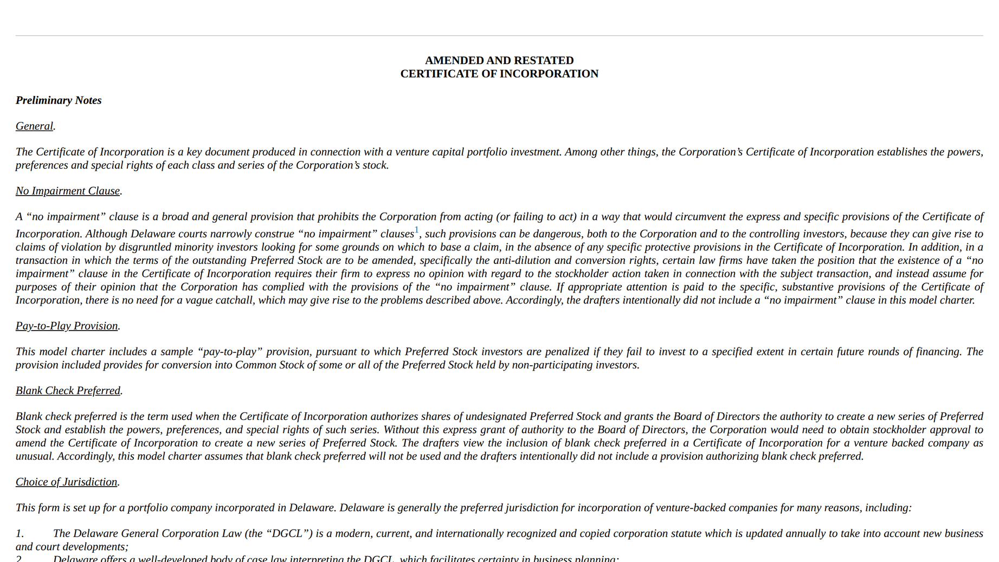
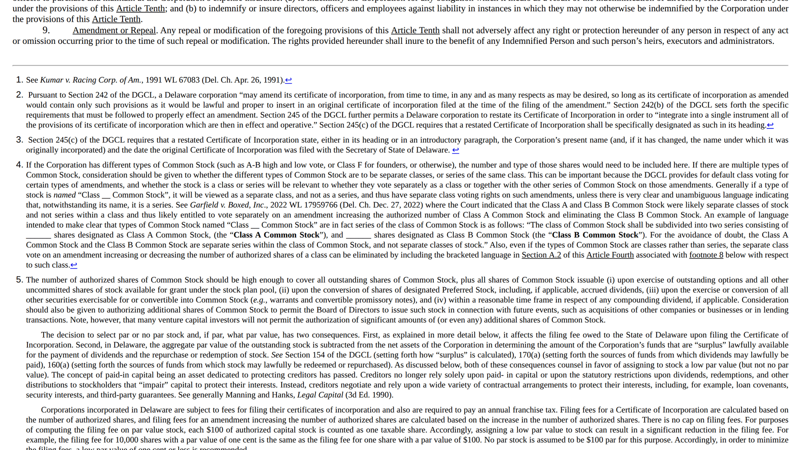

# DOCX to HTML Converter

This document describes the architecture and capabilities of the `WmlToHtmlConverter` module, which converts Word documents (`.docx`) to XHTML.

**Source File:** `OpenXmlPowerTools/WmlToHtmlConverter.cs`

## Overview

The converter transforms Open XML WordprocessingML documents into well-formed XHTML with CSS styling. It processes the document through a multi-stage pipeline that resolves formatting, calculates layout metrics, and transforms elements to their HTML equivalents.



The [NVCA model certificate of incorporation](https://nvca.org/model-legal-documents/) in flow mode.
Justification, style-inherited italics, superscript footnote references and legal numbering all
survive the conversion — resolved by the pipeline below rather than approximated.



With `RenderFootnotesAndEndnotes` on, notes render as a numbered section with a back-reference to
the citing paragraph. In paginated mode the same notes are placed at the bottom of the page that
cites them, above a separator rule — see [`paginated_headers_footers.md`](paginated_headers_footers.md).

## Entry Points

```csharp
// From a WmlDocument (in-memory byte array wrapper)
XElement html = WmlToHtmlConverter.ConvertToHtml(wmlDoc, settings);

// From an open WordprocessingDocument
XElement html = WmlToHtmlConverter.ConvertToHtml(wordDoc, settings);

// Via extension method on WmlDocument
XElement html = wmlDoc.ConvertToHtml(settings);
```

All methods return an `XElement` representing the complete HTML document (the `<html>` element with `<head>` and `<body>`).

Serialize it with `html.ToString()` or `html.ToString(SaveOptions.DisableFormatting)`.
Stylesheets use CSS-commented CDATA sections so child selectors (`p > span`), ampersands,
and CSS string values survive both XML parsing and HTML raw-text parsing (issue #1230).
CSS escapes protect embedded `</style` and `]]>` delimiters without changing string values,
including a less-than sign that the authored CSS already escapes.
The byte-to-HTML facade used by WASM and the stdio host uses this same serialization.
When manipulating the returned tree, preserve its stylesheet nodes rather than replacing
`style.Value` with plain XML text, which would reintroduce entity escaping.

## Configuration

### WmlToHtmlConverterSettings

| Property | Type | Default | Description |
|----------|------|---------|-------------|
| `PageTitle` | `string` | `""` | Content for the `<title>` element |
| `CssClassPrefix` | `string` | `"pt-"` | Prefix for generated CSS class names |
| `FabricateCssClasses` | `bool` | `true` | If true, generates CSS classes; if false, uses inline styles |
| `GeneralCss` | `string` | `"span { white-space: pre-wrap; }"` | Base CSS included in output |
| `AdditionalCss` | `string` | `""` | Custom CSS appended to the style block |
| `RestrictToSupportedLanguages` | `bool` | `false` | Limits language processing |
| `RestrictToSupportedNumberingFormats` | `bool` | `false` | Limits list numbering formats |
| `ListItemImplementations` | `Dictionary<string, Func<...>>` | Default implementations | Custom list item text generators |
| `ImageHandler` | `Func<ImageInfo, XElement>` | `null` | **Required for images** - callback to process embedded images |
| `SemanticLists` | `bool` | `false` | Emit Word lists as `ol`/`ul`/`li` instead of paragraphs (see [Lists](#lists)); ignored by paginated output |

### ImageInfo Structure

When `ImageHandler` is invoked, it receives an `ImageInfo` object:

```csharp
public class ImageInfo
{
    public SKBitmap? Bitmap;           // Decoded image (SkiaSharp)
    public byte[]? ImageBytes;         // Encoded output bytes; TIFF/WMF may be normalized
    public XAttribute? ImgStyleAttribute; // Pre-computed style attribute with dimensions
    public string? ContentType;        // MIME type (e.g., "image/png")
    public XElement? DrawingElement;   // Original Word XML element
    public string? AltText;            // Description from document

    public const int EmusPerInch = 914400;
    public const int EmusPerCm = 360000;

    public void SaveImage(string filePath, SKEncodedImageFormat format, int quality = 100);
}
```

## Processing Pipeline

The conversion happens in the following stages:

### 1. Preprocessing

Run coalescing visits nested containers from the leaves upward on one copy of the input tree.
Each container, including textbox paragraphs, is consolidated once (#1410).

VML drawing containers project each independent member, with nested group coordinate maps
preserving individual textbox and picture bounds (#1482). The ordinary textbox paragraph
converter still owns formatting, contextual spacing, source identities and fixed-box clipping.
The host records expected textbox identities from selected source OOXML; the image/chart paths
record only their actual selected alternatives so a missing image can still fall back to text.
This makes conversion-time loss observable to the paginator's existing completeness check.

```
WordprocessingDocument
    │
    ├─► RevisionAccepter.AcceptRevisions()
    │       Accepts all tracked changes (insertions/deletions)
    │
    ├─► MarkupSimplifier.SimplifyMarkup()
    │       Removes: comments, content controls, footnotes/endnotes,
    │                proofing marks, permissions, RSID info, smart tags,
    │                soft hyphens, GoBack bookmarks
    │
    ├─► FormattingAssembler.AssembleFormatting()
    │       Resolves style inheritance, flattens formatting to explicit properties
    │
    ├─► InsertAppropriateNonbreakingSpaces()
    │       Ensures empty paragraphs render (adds space to empty <p>)
    │
    ├─► CalculateSpanWidthForTabs()
    │       Computes tab widths using font metrics (SkiaSharp)
    │
    ├─► ReverseTableBordersForRtlTables()
    │       Swaps left/right borders for RTL tables
    │
    ├─► AdjustTableBorders()
    │       Resolves conflicting cell borders by priority
    │
    ├─► FieldRetriever.AnnotateWithFieldInfo()
    │       Marks field code regions for hyperlink processing
    │
    └─► AnnotateForSections()
            Marks section boundaries for grouping
```

### 2. Transformation

`ConvertToHtmlTransform()` recursively walks the document tree, converting each element:

```
w:document  ──►  <html>
                   <head>
                     <meta charset="UTF-8"/>
                     <title>...</title>
                     <meta name="Generator" content="PowerTools for Open XML"/>
                   </head>
                   <body>...</body>
                 </html>

w:body      ──►  <body> with section <div> wrappers

w:p         ──►  <p> or <h1>-<h6> (based on outlineLvl in style)

w:r         ──►  <span> with CSS styling

w:t         ──►  text node

w:tbl       ──►  <table> wrapped in alignment <div>

w:tr        ──►  <tr>

w:tc        ──►  <td> with colspan/rowspan

w:hyperlink ──►  <a href="...">

w:drawing   ──►  Result of ImageHandler callback
w:pict

w:tab       ──►  <span> with calculated width

w:br/w:cr   ──►  <br> with directional marks

w:sym       ──►  <span>&#NNN;</span> (symbol as entity)

w:bookmarkStart ──► <a id="..."></a>  (<span id="..."></span> inside a link: an <a> cannot nest)

w:noBreakHyphen ──► "-" (text)
```

### 3. CSS Generation

`ReifyStylesAndClasses()` processes style annotations attached to elements:

**With `FabricateCssClasses = true` (default):**
- Groups elements with identical styles
- Generates CSS class names (e.g., `pt-000001`, or `pt-StyleName` if available)
- Adds `class` attribute to elements
- Creates `<style>` block in `<head>`

**With `FabricateCssClasses = false`:**
- Converts style dictionaries to inline `style` attributes

## Element Mapping Details

### Paragraphs

Paragraphs (`w:p`) are converted based on their style's outline level:

| Outline Level | HTML Element |
|---------------|--------------|
| 0 | `<h1>` |
| 1 | `<h2>` |
| 2 | `<h3>` |
| 3 | `<h4>` |
| 4 | `<h5>` |
| 5 | `<h6>` |
| None/other | `<p>` |

Hidden paragraph marks (`w:pPr/w:rPr/w:vanish`) and style separators (`w:specVanish`)
render following paragraph text as a `<span>` within the first paragraph or heading. Explicit off
values preserve separate blocks. Joining stops at another block container or a section boundary;
range markers such as bookmarks do not create a physical boundary. In paginated mode the merged block takes `data-keep-with-next` and
`data-keep-lines` from its last paragraph (the mark that precedes the next block, so a run-in
heading's own `keepNext` does not chain the block to what follows), and start-anchored
properties such as `data-page-break-before` from its first. Paragraph-mark visibility
does not hide the generated list number; run defaults, run styles, and numbering-level visibility
still apply to the number.

### Paragraph text frames

`w:framePr` identifies a floating paragraph frame. Adjacent paragraphs with identical frame
attributes share one frame, anchored to the next ordinary paragraph, as specified by
[OOXML FrameProperties](https://learn.microsoft.com/en-us/dotnet/api/documentformat.openxml.wordprocessing.frameproperties?view=openxml-3.0.1).
The converter groups their ordinary paragraph HTML inside one `data-docx-text-frame` wrapper.
A placeholder keeps the frame with its following anchor. Drop-cap properties retain their
existing conversion path. Explicit automatic height ignores the stored height; exact and minimum
heights retain their declared size. Omitted anchors use Word's text-relative defaults
([MS-OE376](https://learn.microsoft.com/en-us/openspecs/office_standards/ms-oe376/6ff920ba-f035-407d-aa15-c4e2ad916cb6)).

For `w:yAlign="inline"`, `w:wrap="notBeside"` gives the placeholder the frame's flow height.
Text-anchored `around`, `auto`, `tight` and `through` frames with left-edge placement or explicit
offsets instead leave a zero-height source slot and exclude their occupied area, including
`hSpace`, from following lines. Separate frames keep their own
source positions. `prepareFrameExclusions` represents the active rectangles with a float whose
right edge follows their union, ending each float at the next frame's source slot. That next
slot carries any surviving rectangles into a new exclusion. This prevents CSS float packing
from shifting frames sideways and prevents a later, wider frame from moving an earlier table.
Adjacent distinct frames share one slot; paragraphs with identical properties share one frame.
`wrap="none"` retains overlap. Inline frames directly in a table cell become ordinary paragraphs,
as in Word; a nested text-box story is a separate frame context.

Body admission counts a wrapping frame's painted extent separately from normal flow height.
Header overhangs narrow body lines without consuming that height a second time. Tables and other
formatting contexts that must move below an exclusion contribute their measured clearance after
margin collapse. Running stories use the same wrapping geometry when their fields are refreshed.

The paginator resolves page, margin and text anchors after the ordinary content has flowed.
It then places the frame directly in its page so body and running-story clipping cannot crop
its overhang. Inherited presentation, canonical source identities and table-cell ownership
survive placement; the PageMap measures the positioned source paragraphs. Ordinary running-story
paragraphs retain their existing conversion. Floating-frame geometry supports explicit offsets and
horizontal/vertical alignment.

Inline wrapping has an explicit capability boundary. A positive interior offset keeps complete,
conservative one-sided wrapping and reports that Word's two-sided wrapping is not represented.
This warning describes the general capability; a particular short paragraph may still match Word.
Other horizontal wrapping anchors/alignments and positive `vSpace` use the existing full-height
flow slot with an approximation diagnostic. They preserve authored horizontal placement, all text
and source anchors. `notBeside` horizontal alignment remains supported without a warning, and
`wrap="none"` and non-inline floating frames retain their existing behavior. The shared
unsupported-content policy reports these approximations in normal export and refuses them in
strict export. It does not claim native-equivalent centered wrapping or preceding-line reflow.
Native horizontal wrapping is tracked in [#1509](https://github.com/JSv4/Docxodus/issues/1509),
and vertical clearance that reflows earlier lines in [#1510](https://github.com/JSv4/Docxodus/issues/1510).

### Linked DrawingML text boxes

A `wps:txbx` start and matching `wps:linkedTxbx` continuations form a story within their
owning document part. The converter retains empty continuation frames and records the story,
sequence and linked membership on their wrappers. Membership is recomputed for each conversion,
so editing a document and rendering it again cannot leave stale clipping eligibility. Linked
stories are excluded from fixed-box clipping exemptions.

With read-only paragraph fragmentation enabled, the paginator flows the story through the
frames in sequence using the shared paragraph fragmenter. Frame sizes and inherited typography
are retained; text and inline pictures move as complete supported fragments. Fitting keep groups
move together, while keeps that cannot fit any available frame may relax. Repeated header/footer
chains are resolved separately on each physical page. Source identities continue across frames
and pages through the ordinary PageMap path.

Fit checks include all four content bounds, including the upper edge of vertically aligned
frames. Invalid chains, indivisible content that fits no frame, and exhausted story capacity
report an export error instead of discarding the remaining content.

### Runs (Text Formatting)

Run properties (`w:rPr`) map to CSS:

| Word Property | CSS Property | Notes |
|--------------|--------------|-------|
| `w:b` | `font-weight: bold` | |
| `w:i` | `font-style: italic` | |
| `w:u` | `text-decoration: underline` | Unless `val="none"` |
| `w:strike`, `w:dstrike` | `text-decoration: line-through` | |
| `w:caps` | `text-transform: uppercase` | |
| `w:smallCaps` | `font-variant: small-caps` | |
| `w:vanish` | `display: none` | Unless `w:specVanish` |
| `w:color` | `color: #RRGGBB` | `auto` → `black` |
| `w:highlight` | `background: <color>` | Named colors |
| `w:shd` | `background: #RRGGBB` | With pattern blending |
| `w:sz` | `font-size: Npt` | Value in half-points |
| `w:spacing` | `letter-spacing: Npt` | |
| `w:position` | `position: relative; top: Npt` | Superscript/subscript offset |
| `w:vertAlign` | `<sup>` or `<sub>` wrapper | `superscript`/`subscript` |
| `w:bdr` | `border: solid windowtext 1pt` | |

### Tables

Tables are wrapped in a `<div>` for alignment control:

```html
<div dir="ltr" align="left">
  <table dir="ltr" style="border-collapse: collapse; border: none; ...">
    <tr style="height: 0.25in">
      <td colspan="2" rowspan="1" style="border: solid black 1pt; ...">
        <!-- cell content -->
      </td>
    </tr>
  </table>
</div>
```

**Border Conflict Resolution:**

When adjacent cells have different borders, priority is determined by:
1. Border style weight (single < thick < double < dotted, etc.)
2. Border size (`w:sz` attribute)
3. Border style type priority
4. Color value (lower hex value wins)

### Hyperlinks

**External links** (`w:hyperlink` with `r:id`):
```html
<a href="https://example.com" style="color: inherit; text-decoration: none">link text</a>
```

**Bookmark links** (`w:hyperlink` with `w:anchor`):
```html
<a href="#bookmarkName" style="color: inherit; text-decoration: none">link text</a>
```

Hyperlink conversion preserves child containers and revision wrappers as well as direct runs,
using the existing tab-layout path. Custom XML shares the content-control traversal: its metadata
does not render, while its content flows through inline conversion or block border grouping. This
applies to normal and paginated HTML (#1188).

The anchor suppresses browser-default link presentation. Explicit Word run styling inside the link
still wins in ordinary links. Cached `TOC` field results are the semantic exception: Word suppresses
hyperlink color and underline there even when a run references the `Hyperlink` character style.
`FieldRetriever` annotates the complex-field stack before transformation, and run conversion removes
only those two presentation properties when the run is both inside `w:hyperlink` and inside a `TOC`
result. Removing rather than replacing them exposes the document's underlying TOC formatting.

**HYPERLINK fields** (detected via `FieldRetriever`):
```html
<a href="url-from-field">field content</a>
```

### Ruby annotations

`WmlToHtmlConverter.Ruby.cs` resolves ruby size precedence before formatting assembly: `w:hps`
overrides annotation run sizes, while an explicit base run size wins over `w:hpsBaseText`.
Direct horizontal text runs use `ruby` / `rt` / `rp`, retaining run formatting and annotation
language. A marked inline-block wrapper keeps the pair atomic. The shared line-metrics pass
measures native ruby baselines after font preparation, shifts the annotation to the authored
baseline distance, and reserves the corresponding signed change in line height, including
hidden note registries. Fragment endpoints never enter the pair; line-boundary decisions use
the base, while annotation ink remains part of layout measurement.
Chromium's PDF paint path can round the measured baseline distance to CSS pixels; its tagged
output retains pair association, with role names depending on the Chromium version. See the
Ruby corner case for the measured bounds.

Vertical ruby alignment, bidi paragraphs, tabs, exact-spaced paragraphs and shifted/scripted
runs use a complete readable fallback. Its diagnostic participates in the existing strict
export policy. With placeholders disabled, both text layers still render. Exact fallback
runs share the enclosing run's baseline correction and use their own natural line heights.

### Tabs

Before revision acceptance, simplification and formatting, `ExpandLiteralTextTabs` replaces literal
U+0009 characters in `w:t` and `w:delText` with canonical `w:tab` elements across all content parts
(#1353). This includes a tab-only run, mixed text, and leading, consecutive or trailing tabs. Text
fragments retain their attributes and their run's formatting/revision owner. Field instructions
(`w:instrText`) remain unchanged: their tab characters are instruction whitespace, not layout tabs.
The normal stop, leader and browser-flex calculations below then handle both representations.
Revision wrappers reuse the same aligned-tab renderer as paragraph content when field boundaries
permit it. Tab measurements include visible deleted text and skip hidden deletion/move-source
content, so hidden revisions do not advance the live pen. Revision ownership and formatting stay
on the outer wrapper and its runs. Neutral flex segments and text items explicitly inherit
text decoration, because CSS does not paint an outer revision's underline or strike through
an atomic inline flex box.

`CalculateSpanWidthForTabs` measures the current position and following segment, then annotates each
tab with the advance needed for its OOXML target. Left/right tab sequences use character-class
fallback widths to choose a stop; fixed-pitch prefixes retain constant advances. Plain left/right
segments in left-to-right paragraphs become fixed-width inline flex rows, including the following text in a right segment.
The browser assigns font-metric differences to the tab remainder, so later tabs retain their own
stops and page-number right edges follow actual glyph widths. The same grouping is used inside
`w:hyperlink`. Bookmarks, non-breaking hyphens and underlined or struck tab runs stay on the flex path. A
right stop past the line end (inside the paragraph's right indent, or past the column edge) gives its segment
a negative `margin-right` equal to the overhang, so the segment fits on its line and still ends on the stop.
Past the line end the line has no room left, yet LibreOffice keeps a short later tab stretch on the same line, so
the following content goes in one nowrap, content-wide box whose left margin undoes that overhang and whose `-100%` right margin takes it off the line; a
second right or left stop inside the indent then lands on its own stop (issue #1285). A pen past the line
end only because a right-aligned stretch ended on such a stop does not count as wrapped text.
If text after the final left tab would exceed the column edge, the paragraph keeps the ordinary wrapping
path. Forcing that text into the same nowrap box would send it past the page and lose visible words.
Likewise, a right tab whose following text exceeds both the column and its authored stop keeps
ordinary, fragmentable flow (#1488). Its following width is the sum of the actual runs' resolved
fonts and sizes, with letter spacing included by the shared run measurement. A short tail whose
browser glyphs are wider than that estimate can shrink and wrap within its segment; fitting tails
still end on their stop. Deliberate overhanging stops retain their existing treatment.

Complex fields stay on the flex path: their begin, instruction, separator and end runs draw nothing, so a
table-of-contents page number held in a `PAGEREF` field ends on the stop like plain text (issue #1285).
Each stretch converts its fields on its own, so a field open across a tab would be cut in two; a field the
converter wraps whole (a `HYPERLINK` link, or a `PAGE`/`NUMPAGES` marker) therefore keeps the run-aware
path when it is cut. A form field's begin carries form data that renders, and also keeps that path.

Text before a right tab that runs past the line end usually keeps the run-aware path (issue #891). When
that text began at the left indent, where its later lines begin too (a long hanging-indent TOC title), the
segment instead starts at the left indent and reaches the stop. The text wraps inside it at the line end,
and the segment aligns its last line with the following text (`align-items: last baseline`), so the page
number ends on the stop beside the last title line. The tab takes no room after the title's last word;
its leader is as wide as the segment and is clipped (`overflow-x: clip`) where the number begins.
The prefix keeps its minimum word width, and the segment can wrap onto another flex line if
the following text leaves less room than that. This prevents an underestimated tail from
collapsing the clipped title to zero width; fitting page-number lines retain their geometry.

Bidirectional paragraphs, breaks, active comment/annotation ranges (including a bookmark
that opens a rendered annotation) and tab runs with visibility, revision or exceptional geometry retain
the run-aware path and its conservative following-text reservations. Leader rules inherit the tab run's resolved foreground color.

```html
<span style="align-items: baseline; display: inline-flex; width: 4.000in">
  <span style="flex-shrink: 0">Before</span>
  <span style="display: inline-block; flex: 1 1 0; min-width: 0; color: blue">
    <span data-docx-tab="right" data-docx-tab-width="3.500" style="width: 100%"></span>
  </span>
  <span style="flex-shrink: 0">After</span>
</span>
```

**Tab types supported:**
- `left`/`start` - Content starts at tab position
- `right`/`end` - Content ends at tab position
- `center` - Content centered at tab position
- `decimal` - Decimal point aligned at tab position

**Tab leaders:**
- `dot` (.) `hyphen` (-) `underscore` (_)
- Rendered as dotted, dashed, or solid rules across the exact tab box; leader fill therefore does
  not depend on whether the document font is installed in the native or WASM runtime.

### Images

Images require an `ImageHandler` callback. PNG, GIF and JPEG retain their encoded bytes.
The shared DrawingML/VML path in `WmlToHtmlConverter.Images.cs` normalizes two bounded subsets
before invoking that callback, identically in native and WASM builds:

- Classic, single-page TIFF: chunky unsigned 8-bit RGB/RGBA, uncompressed or PackBits strips,
  either byte order, orientations 1–8 and associated/unassociated alpha. Output is RGBA PNG.
  LZW/Deflate, tiles, palette/grayscale, custom colorimetry/profiles and multi-page files retain
  an unsupported-content diagnostic.
- Placeable WMF (`image/x-wmf` or `image/wmf`): positive anisotropic windows, rectangle/ellipse
  records and positive-width solid/null pens and solid/null brushes. Output is static SVG with
  a bounded object table and record count. Word's device-pixel endpoint exclusion is resolved
  in logical coordinates; window mapping and later picture sizing stretch the complete painted
  graphic, including its outline. Visible zero-width device pens, collapsed bounds and unknown
  records reject the whole image; text, bitmaps, clipping and other map modes remain unsupported.

Input is limited to 64 MiB; normalized dimensions are limited to 32,768 per axis and
16 megapixels. Source EMF and SVG image parts retain their existing placeholders. Generated
WMF SVG contains only numeric geometry and paint attributes, with no external resources.
`ImageInfo.ContentType` names the output encoding and `ImageBytes` holds those encoded bytes;
`Bitmap` can be null for vector output. Handlers should preserve the encoded resource.

**Example ImageHandler:**

```csharp
settings.ImageHandler = imageInfo =>
{
    return new XElement(Xhtml.img,
        new XAttribute("src", $"data:{imageInfo.ContentType};base64,{Convert.ToBase64String(imageInfo.ImageBytes!)}"),
        new XAttribute("alt", imageInfo.AltText ?? ""),
        imageInfo.ImgStyleAttribute);
};
```

### Charts

Standard DrawingML `c:barChart` parts with `clustered` grouping render as accessible inline SVG.
Both column (`c:barDir="col"`) and horizontal bar (`c:barDir="bar"`) directions are supported. The
converter reads the chart's portable cached categories, series names, and numeric values rather than
recalculating the optional embedded workbook, and preserves the drawing's stored `wp:extent`.

The SVG projection includes the title, value grid and labels, category labels, bottom legend,
gap/overlap, explicit or inferred value scale, theme/default series colors, and DrawingML text sizes.
It carries `role="img"`, an `aria-label`, a `<title>`, and stable `data-chart-*` attributes for
inspection. Unsupported chart families and stacked/percent-stacked groupings continue through the
existing drawing fallback; 3-D effects, trend lines, data labels, secondary axes, and exact Office
chart styling are not projected.

### Lists

By default a numbered or bulleted paragraph converts to a `<p>` like any other. Its marker is the
text Word would draw, in a `data-list-marker` span followed by a tab span, and the level's indent is
the paragraph's left margin with a negative first-line indent. That renders correctly, but nothing
in the markup says "list".

With `SemanticLists` on (issue #895), lists come out as lists:

- **Facts.** Formatting assembly discards `w:numPr` once it has computed the marker, so under the
  setting it stamps each list paragraph with its `w:num` id, the level it nests at, the counter
  value its marker shows, and the level's `w:numFmt` (`pt:ListNumId`, `pt:ListLevel`,
  `pt:ListValue`, `pt:ListFormat`). The level is the *effective* level: a continuation item, which
  Word draws with level 0's format, counts as level 0. A numbered heading stays an `h1`–`h6`.
- **Grouping.** After conversion, and before styles become classes, `GroupSemanticLists` walks each
  element's children. A run of adjacent list paragraphs becomes lists: items of one list at one
  level share an `ol` (numbered) or `ul` (`bullet`), a deeper level opens a list inside the
  preceding `li`, and a different list (or numbered after bulleted) at the same level starts a
  sibling list. Anything else between two items ends the run, so a list never crosses a table cell,
  a note or a section. Each `<p>` is renamed `<li>`, keeping its classes, `data-anchor` and
  `data-source-anchor-id`.
- **Markers.** CSS draws the markers of a list only when, for every item, the marker is followed by
  a tab, hangs in a hanging indent, is formatted exactly like the item itself (family, size, weight,
  style, colour and decoration, since a `::marker` takes the item's formatting), is in the same font
  family and size as the item's first text run (so its line box is not the tallest on the line), and
  its text is exactly what one `list-style-type` generates for the item's value: `decimal`,
  `decimal-leading-zero`, `lower-/upper-alpha` or `lower-/upper-roman` followed by a period, or the
  bullets `•` (`disc`), `◦` (`circle`) and `▪`/`■` (`square`). Those lists lose their marker spans
  and get `start` (and `value` where the count jumps). Every other list (`(a)`, `1)`, `1.1.`, a
  marker in another font, a lettered list past `z`, where Word and CSS count differently) keeps its
  marker spans under `list-style-type: none`, and its items stay `display: block`.
- **Geometry.** Each item keeps its own leading and trailing indents, measured from the item it is
  nested in rather than from the page, so nested indents don't compound. `ol`/`ul` get no margin,
  padding or text indent of their own, and a nested list resets `text-align` and `line-height` so its
  items don't inherit their parent paragraph's. An item's space after moves to the top of its nested
  list, which is where it fell when both were paragraphs. A right-to-left item measures its indent on
  the right. Under the setting, the notes section's padding rule selects only the notes list itself
  (`section.footnotes > ol`), so lists inside a note body keep their own indent.
- **Known limit.** A nested list sits inside its parent item's box, so a parent item's shading
  (`w:shd`) or a Word-style revision change bar extends down beside its nested items.

Rendered in a standards-mode page, the list form of every `TestFiles/` fixture places each block's
first character exactly where the paragraph form does. In a page without a doctype (quirks mode),
Chromium lays a list item's line out slightly differently, and a CSS-marked item can sit up to
1.4 px higher. The marker font rule above exists because a `::marker` takes the item's font: where
the marker run is taller than the text, dropping its span shortened the first line (by 9 px in
`WC-BodyBookmarks-Before.docx`).

Paginated output ignores the setting, because the paginator measures and splits paragraphs.

### Bidirectional Text (RTL)

The converter handles right-to-left text:

1. **Paragraph-level:** `w:bidi` element triggers `dir="rtl"` and flips margins/alignment
2. **Run-level:** `w:rtl` element adds directional marks (RLM `&#x200f;`)
3. **Table-level:** `w:bidiVisual` reverses left/right borders and alignment

Directional marks ensure proper text rendering:
- LRM (`&#x200e;`) - Left-to-right mark
- RLM (`&#x200f;`) - Right-to-left mark

## CSS Property Mapping

### Paragraph Spacing

| Word Property | CSS Property |
|--------------|--------------|
| `w:spacing/@w:before` | `margin-top` |
| `w:spacing/@w:after` | `margin-bottom` |
| `w:spacing/@w:line` (auto) | `line-height: N%` (where N = line/240*100) |
| `w:spacing/@w:line` (exact) | `line-height: Npt` |

Exact spacing also carries `--docx-exact-line-height` and marks the converted runs with
`data-docx-exact-run`. After paragraph placement, the paginator uses the browser's font metrics
to put their baselines at 80% of the exact line height without enlarging any line box. Fitting
exact-spaced text may paint into the page margins, bounded by the paper and running stories;
see the measured #882 entry in `docs/ooxml_corner_cases.md`.

### Indentation

| Word Property | CSS Property |
|--------------|--------------|
| `w:ind/@w:start` or `@w:left` | `margin-left` (or `margin-right` for RTL); `w:start` wins if both |
| `w:ind/@w:end` or `@w:right` | `margin-right` (or `margin-left` for RTL); `w:end` wins if both |
| `w:ind/@w:firstLine` | `text-indent` |
| `w:ind/@w:hanging` | `text-indent` (negative) |

### Justification

| `w:jc/@w:val` | CSS `text-align` |
|---------------|------------------|
| `left` | `left` (or `right` for RTL) |
| `right` | `right` (or `left` for RTL) |
| `center` | `center` |
| `both` | `justify` |

### Borders

Border styles map to CSS with approximations:

| Word Border | CSS Border |
|-------------|------------|
| `single` | `solid` |
| `dotted` | `dotted` |
| `dashed`, `dashSmallGap`, `dotDash`, `dotDotDash` | `dashed` |
| `double`, `triple` | `double` |
| `thinThick*`, `thickThin*` | `double` |
| `wave`, `doubleWave` | `solid` / `double` |
| `threeDEmboss` | `ridge` |
| `threeDEngrave` | `groove` |
| `outset` | `outset` |
| `inset` | `inset` |

### Colors

Named colors are mapped:

| Word Color | CSS Color |
|------------|-----------|
| `black` | `black` |
| `blue` | `blue` |
| `cyan` | `aqua` |
| `green` | `green` |
| `magenta` | `fuchsia` |
| `red` | `red` |
| `yellow` | `yellow` |
| `white` | `white` |
| `darkBlue` | `#00008B` |
| `darkCyan` | `#008B8B` |
| `darkGreen` | `#006400` |
| `darkMagenta` | `#800080` |
| `darkRed` | `#8B0000` |
| `darkYellow` | `#808000` |
| `darkGray` | `#A9A9A9` |
| `lightGray` | `#D3D3D3` |
| `auto` | `black` (foreground) or `white` (background) |

Hex colors (e.g., `FF0000`) are output as `#FF0000`.

### Font Families

Common fonts include CSS fallbacks:

```css
font-family: 'Arial', 'sans-serif'
font-family: 'Times New Roman', 'serif'
font-family: 'Courier New'
```

## Limitations

### Content Removed During Preprocessing

The following are **discarded** and will not appear in output:

- Comments (`w:comment`)
- Footnotes and endnotes (`w:footnote`, `w:endnote`)
- Content controls (`w:sdt`) - contents preserved, control removed
- Proofing marks (`w:proofErr`)
- Revision tracking info (RSID attributes)
- Smart tags
- Soft hyphens
- Permissions
- GoBack bookmarks

### Not Implemented

**Paragraph properties:**
- `w:framePr` - Frames/text boxes positioning
- `w:keepLines`, `w:keepNext` - Pagination control
- `w:pageBreakBefore` - Page breaks
- `w:widowControl` - Widow/orphan control
- `w:textDirection` - Vertical text
- `w:wordWrap` - Word wrapping control
- `w:mirrorIndents` - Mirrored margins
- `w:suppressOverlap` - Overlap control
- `w:snapToGrid` - Grid snapping

**Run properties:**
- `w:em` - East Asian emphasis marks
- `w:emboss`, `w:imprint` - 3D text effects
- `w:outline`, `w:shadow` - Text effects
- `w:kern` - Kerning
- `w:fitText` - Text scaling
- `w:w` - Character width scaling

**Document features:**
- Math equations (OMML)
- Chart families other than clustered column/horizontal bar charts
- Diagrams (SmartArt)
- Complex text boxes
- Headers and footers
- Page numbers
- Table of contents (rendered as static text)
- Cross-references (rendered as static text)
- Multi-column layouts
- Page breaks / section breaks

### Field Code Limitations

Only **HYPERLINK** fields are converted to `<a>` elements. All other field types are rendered as their display text only:
- TOC, INDEX, XE
- REF, PAGEREF, NOTEREF
- DATE, TIME
- AUTHOR, TITLE
- SEQ, LISTNUM
- etc.

### Image Limitations

- **TIFF/WMF subsets only** - Unsupported encodings or records produce explicit diagnostics
- **EMF not supported** - Not in allowed content types
- **SVG not supported** - Not in allowed content types
- **Requires ImageHandler** - Returns `null` without callback

### Font Metrics

Native tab width calculation uses SkiaSharp font metrics. WASM and unavailable-font paths use a
deterministic character estimate normalized into the same 96-DPI layout space. Post-tab alignment
uses the measured following run, while the inline flex wrapper absorbs current-run metric drift into
the tab box. System font availability can still affect wrapping and the small residual difference
between an aligned glyph edge and its target.

### Browser Compatibility

- Vertical text alignment (`w:textAlignment`) noted as not working in major browsers
- Some border styles are approximations
- Complex RTL layouts may vary by browser

## Output Structure

```html
<!DOCTYPE html>
<html>
  <head>
    <meta charset="UTF-8"/>
    <title>Document Title</title>
    <meta name="Generator" content="PowerTools for Open XML"/>
    <style>
      span { white-space: pre-wrap; }
      p.pt-Normal { margin-top: 0; margin-bottom: 10pt; ... }
      span.pt-DefaultParagraphFont { font-family: 'Calibri'; ... }
      /* ... generated classes ... */
    </style>
  </head>
  <body>
    <div>
      <!-- Section content -->
      <h1 class="pt-Heading1" dir="ltr">...</h1>
      <p class="pt-Normal" dir="ltr">
        <span class="pt-000001">Text content</span>
      </p>
      <div dir="ltr" align="left">
        <table>...</table>
      </div>
    </div>
  </body>
</html>
```

## Usage Example

```csharp
using OpenXmlPowerTools;
using System.Xml.Linq;

// Load document
var wmlDoc = new WmlDocument("document.docx");

// Configure settings
var settings = new WmlToHtmlConverterSettings
{
    PageTitle = "My Document",
    FabricateCssClasses = true,
    AdditionalCss = "body { max-width: 800px; margin: auto; }",
    ImageHandler = imageInfo =>
    {
        // Convert to base64 data URI
        var base64 = Convert.ToBase64String(imageInfo.ImageBytes);
        var dataUri = $"data:{imageInfo.ContentType};base64,{base64}";

        return new XElement(Xhtml.img,
            new XAttribute("src", dataUri),
            new XAttribute("alt", imageInfo.AltText ?? ""),
            imageInfo.ImgStyleAttribute);
    }
};

// Convert
XElement html = WmlToHtmlConverter.ConvertToHtml(wmlDoc, settings);

// Save to file
html.Save("output.html", SaveOptions.DisableFormatting);
```

## Related Files

- `OpenXmlPowerTools/WmlToHtmlConverter.cs` - Main converter implementation
- `OpenXmlPowerTools/HtmlToWmlConverter.cs` - Reverse conversion (HTML to DOCX)
- `OpenXmlPowerTools/RevisionAccepter.cs` - Track changes acceptance
- `OpenXmlPowerTools/MarkupSimplifier.cs` - Document cleanup
- `OpenXmlPowerTools/FormattingAssembler.cs` - Style resolution
- `OpenXmlPowerTools/FieldRetriever.cs` - Field code processing
- `OpenXmlPowerTools/PtOpenXml.cs` - Custom annotation namespace

## Formatting revision descriptions

With tracked-change rendering enabled, formatting assembly resolves each run's previous `rPr`
through the same default, paragraph, table and character-style rules as its current properties
(issue #1222). An empty previous snapshot, including one removed by markup simplification, means
inherited formatting. Descriptions compare those effective properties and honor explicit off
values. The extra resolution is internal to HTML rendering; ordinary `FormattingAssembler`
callers keep the original revision snapshots.

## Run text decorations

The shared run-style conversion preserves underline and strike independently (issue #1220).
Single, double, dotted, dashed and wavy underlines use CSS text decorations; explicit and theme
underline colors resolve through the same color helper as run text. Double strike uses a double
line-through. When both lines share their pattern and color, one decoration draws both. Otherwise,
a nested inline span draws the strike so it keeps its own pattern and text color. A cached TOC
hyperlink still suppresses its underline without removing a strike.

Heavy variants increase decoration thickness. CSS has no direct double-wave or dot-dash equivalent;
those variants use wavy or dashed lines respectively. Word's word-only underline retains the existing
continuous underline rendering. These approximations do not change run text or line metrics.

CSS paints a decoration across text only, never across an atomic inline box, so a tab advance in an
underlined or struck run (a `By: ____` signature line) would show no line (issue #1285). The tab box
draws the run's lines itself: each is the top border of an empty block inside the tab, moved with a
relative offset to where Chromium draws a text underline (`0.05em` below the baseline) or line-through
(`0.3em` above it). The blocks take no room, so neither the advance nor the line height changes, and a
leader keeps the tab's own bottom border. Double lines use a double border, a heavy underline a 2px
border, and a wavy one a solid border. A word-only underline skips tabs, and a cached TOC hyperlink
drops the underline from its tabs as from its text.

Both fixed and flexible tabs go through the run renderer, so a leading tab keeps its run's font,
colour and visibility. A complex HYPERLINK before or spanning a tab stays whole; converting its runs
individually would leave its text and bookmark targets outside the link. The paragraph uses the shared
field-context annotations to choose that path.


### Legacy form results

After formatting assembly, `NormalizeFieldResults` resolves complete `FORMCHECKBOX` and
`FORMDROPDOWN` fields from metadata on their begin character. This happens before paragraph
emptiness and tab measurement, so metadata-only selections occupy the same space as cached
text. Result leaves are replaced within their original run/revision boundaries; non-result
instructions and reference/range markers are retained. Complete `FORMTEXT` caches pass through.
Checkboxes are static read-only accessible spans with CSS borders; unsupported metadata uses
the configured placeholder policy. See [the form-field corner case](../ooxml_corner_cases.md#legacy-form-metadata-lives-inside-the-fields-begin-character-1480).

### Property and paragraph-style fields

`NormalizeFieldResults` shares result ownership for simple and complex fields. It first resolves
legacy forms and read-only `TITLE` / `DOCPROPERTY Title`, then rebuilds field annotations before
resolving `STYLEREF`. An outer result can replace nested cached fields; instruction input stays
hidden, including its note references. Replacement retains visible result formatting and range
anchors. Locked property/style fields retain their caches. An absent title preserves the cache and
uses the configured unsupported-field diagnostic; an explicitly empty title clears the result.
Write-form TITLE arguments and unsupported properties/switches preserve their caches and report
through the same placeholder policy.

Style references match an exact paragraph style's friendly name, then its ID; numeric 1–9 selects
Heading 1–9. Body fields search preceding text, then following text if no preceding match exists.
Textboxes and character styles are outside this resolver. Visible text uses the existing text
extraction helper, including special hyphens and symbols; deleted/hidden instruction text does not
become the heading. Running stories emit `data-field="STYLEREF"` with the canonical style ID and
optional last-on-page flag. Source paragraphs carry the full heading text through fragmentation.
See [paginated headers and footers](paginated_headers_footers.md#running-style-references).
